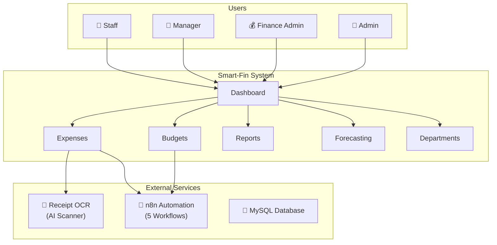
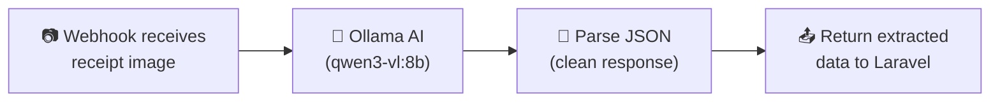
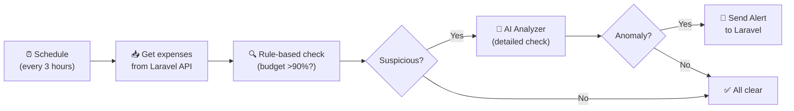
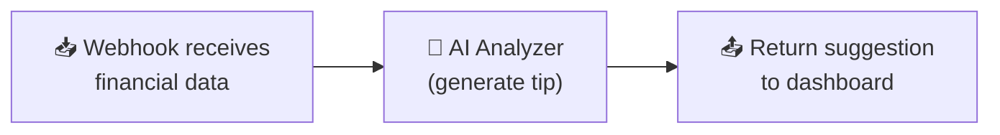
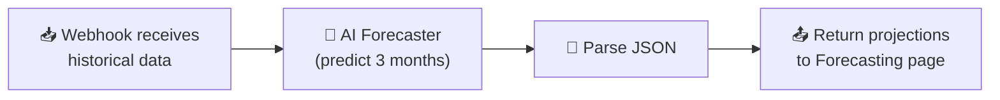
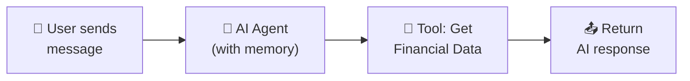

# Smart-Fin 360 - Complete System Workflow Guide 📊
## System Overview

---
## User Roles & Permissions
| Role | Can Do |
|------|--------|
| **Staff** | Submit expenses, view own expenses, view analytics |
| **Manager** | Approve/reject expenses, view reports, forecasting, department expenses |
| **Finance Admin** | Approve budgets, adjust funds, reports, forecasting, manage departments |
| **Admin** | Everything + manage users + manage departments |
---
## Login Credentials
| Role | Email | Password |
|------|-------|----------|
| Admin | `admin@example.com` | `password` |
| Manager | `manager@example.com` | `password` |
| Staff | `staff@example.com` | `password` |
| Finance Admin | `financeadmin@example.com` | `password` |
---
## Departments in System
- Finance
- Human Resources
- Information Technology
- Marketing
- Sales
- Operations
---
# WORKFLOW GUIDE BY ROLE
---
## 1. Staff Workflow 👷
**Main job:** Submit expense claims, track status, and view personal analytics.
### Available Pages:
| Page | Route | Description |
|------|-------|-------------|
| Dashboard | `/dashboard` | Quick expense submit, overview |
| My Expenses | `/my-expenses` | View all submitted expenses |
| Analytics | `/analytics` | Personal expense analytics & charts |
### Testing Steps:
1. **Login** as `staff@example.com`
2. On Dashboard, find the **"Submit New Expense"** section
3. Click **"Upload Receipt"** and select an image
4. Wait for AI to scan and auto-fill fields
5. Select a **Budget** from the dropdown
6. Click **Submit**
7. View your expense in **"My Expenses"** list
8. Go to **Analytics** (`/analytics`) to see your spending charts
---
## 2. Manager Workflow 👔
**Main job:** Review and approve/reject team expenses, view department data.
### Available Pages:
| Page | Route | Description |
|------|-------|-------------|
| Dashboard | `/dashboard` | Pending expenses, spending charts |
| Expense Approvals | `/expenses/approvals` | Approve/reject expenses |
| Department Expenses | `/manager/expenses` | View all department expenses |
| Forecasting | `/forecasting` | Budget/expense forecasting |
| Budget Report | `/budgets/report` | Budget analytics |
### Testing Steps:
1. **Login** as `manager@example.com`
2. On Dashboard, look for **"Pending Expenses"** section
3. Click **Approve** or **Reject** on expenses
4. Go to **Department Expenses** (`/manager/expenses`) to view team spending
5. Go to **Forecasting** (`/forecasting`) for budget predictions
---
## 3. Finance Admin Workflow 💰
**Main job:** Manage budgets, departments, and monitor financial health.
### Available Pages:
| Page | Route | Description |
|------|-------|-------------|
| Dashboard | `/dashboard` | Overview, alerts |
| Budgets | `/budgets` | Manage all budgets |
| Departments | `/departments` | Manage departments |
| Reporting | `/reporting` | Advanced analytics |
| Forecasting | `/forecasting` | Budget predictions |
| Budget Report | `/budgets/report` | Budget analytics |
### Testing Steps:
1. **Login** as `financeadmin@example.com`
2. Go to **Budgets** page - Approve or Reject pending budgets
3. Go to **Departments** (`/departments`) to manage departments
4. Go to **Reporting** (`/reporting`) for advanced analytics
---
## 4. Admin Workflow 👑
**Main job:** Full system control including user and department management.
### Available Pages:
| Page | Route | Description |
|------|-------|-------------|
| Dashboard | `/dashboard` | Full system overview |
| Users | `/users` | Manage all users |
| Departments | `/departments` | Manage departments |
| Budgets | `/budgets` | View/manage budgets |
### Testing Steps:
1. **Login** as `admin@example.com`
2. Go to **Users** (`/users`) to manage accounts
3. Go to **Departments** (`/departments`) to manage departments
---
# n8n WORKFLOWS (AI AUTOMATION) 🔄
Smart-Fin uses 5 n8n workflows to automate AI-powered tasks.
## Workflow Overview
| # | Workflow Name | Trigger | What It Does |
|---|---------------|---------|--------------|
| 1 | **Receipt Processor** | Webhook (POST) | Scans receipt image → extracts category, amount, description |
| 2 | **Anomaly Detector** | Schedule (every 3 hours) | Checks expenses for suspicious activity → sends alerts |
| 3 | **AI Suggestor** | Webhook (POST) | Analyzes spending → gives financial tips |
| 4 | **Expense Forecasting** | Webhook (POST) | Predicts next 3 months of expenses |
| 5 | **Chatbot** | Webhook (POST) | AI chat assistant that answers finance questions |
---
## 1. SmartFin Receipt Processor 📷
**Purpose:** Automatically read receipt images and extract data using AI.
### Flow Diagram:

### How It Works:
1. Staff uploads receipt image in Laravel
2. Laravel sends image to n8n webhook (`/webhook/process-receipt`)
3. AI vision model reads the receipt image
4. Extracts: **category**, **description**, **amount**, **date**, **merchant**
5. Returns JSON back to Laravel
6. Form auto-fills with extracted data
### AI Model Used: `qwen3-vl:8b` (Ollama - vision model)
### Output Example:
```json
{
  "category": "Food & Drink",
  "description": "Coffee purchase at Starbucks",
  "data": {
    "amount": "15.90",
    "date": "2025-01-27",
    "merchant": "Starbucks"
  }
}
```
---
## 2. SmartFin Anomaly Detector 🚨
**Purpose:** Automatically detect suspicious spending patterns and alert managers.
### Flow Diagram:

### How It Works:
1. **Runs every 3 hours** automatically
2. Fetches all expense data from Laravel API
3. **Rule-based checks:**
   - Budget usage > 90%?
   - Duplicate transactions?
4. If suspicious → sends to AI for deeper analysis
5. AI checks for:
   - Unusual spending spikes
   - Duplicate transactions
   - Budget overuse
6. If anomaly found → sends alert to Laravel dashboard
### AI Model Used: `gpt-oss:20b` (Ollama)
### Alert Output:
```json
{
  "anomaly": true,
  "severity": "warning",
  "summary": "IT department has used 95% of monthly budget with 10 days remaining"
}
```
---
## 3. SmartFin AI Suggestor 💡
**Purpose:** Analyze user's spending and provide personalized financial tips.
### Flow Diagram:

### How It Works:
1. Dashboard sends user's financial data to n8n
2. AI analyzes spending patterns
3. Returns **1 actionable tip** (1-2 sentences)
4. Displayed on user's dashboard
### AI Model Used: `gpt-oss:20b` (Ollama)
### Example Tips:
- "Your Food & Drink spending is RM450 this month, 30% above average. Consider meal prepping to save RM100+."
- "You've been approved for all 12 expense claims. Keep maintaining accurate receipts."
---
## 4. SmartFin Expense Forecasting 📈
**Purpose:** Predict future expenses based on historical data.
### Flow Diagram:

### How It Works:
1. Forecasting page sends historical expense data
2. AI analyzes trends and patterns
3. Predicts **next 3 months** of expenses
4. Returns projections with confidence score
5. Displayed as chart on Forecasting page
### AI Model Used: `gpt-oss:20b` (Ollama)
### Output Example:
```json
{
  "projections": [
    { "date": "2025-02-01", "amount": 5200, "reasoning": "Based on Q1 average" },
    { "date": "2025-03-01", "amount": 4800, "reasoning": "Expected decrease after project ends" },
    { "date": "2025-04-01", "amount": 5500, "reasoning": "Annual conference month" }
  ],
  "confidence_score": 0.85
}
```
---
## 5. SmartFin Chatbot 💬
**Purpose:** AI assistant that answers financial questions using real data.
### Flow Diagram:

### How It Works:
1. User types question in chat widget
2. AI agent receives message with **memory** (remembers conversation)
3. AI can **fetch real financial data** from Laravel API
4. Returns helpful response
### AI Model Used: `gpt-oss:20b` (Ollama)
### Features:
- **Memory:** Remembers previous messages in conversation
- **Tool Access:** Can query real expense/budget data
- **Per-user sessions:** Each user has their own chat history
### Example Conversation:
> **User:** "How much did I spend on travel this month?"  
> **AI:** "You've spent RM320 on travel this month across 3 transactions."
---
## Setting Up n8n Workflows
### Step 1: Access n8n
1. Start Docker: `docker-compose up -d`
2. Open http://localhost:5678
3. Create account (first time only)
### Step 2: Import Workflows
1. Go to **Workflows** → **Import**
2. Import each JSON file from `/n8n/` folder:
   - `SmartFin Receipt Processor.json`
   - `SmartFin Anomaly Detector.json`
   - `SmartFin AISuggestor.json`
   - `SmartFin Expense Forecasting.json`
   - `SmartFin Chatbot.json`
### Step 3: Configure Credentials
You need to set up:
- **Ollama API** - Points to your local Ollama server
- **HTTP Bearer Auth** - Laravel API token for authentication
### Step 4: Activate Workflows
Toggle each workflow to **Active** (green switch)
---
# QUICK REFERENCE
## All Routes by Role
| Route | Staff | Manager | Finance Admin | Admin |
|-------|:-----:|:-------:|:-------------:|:-----:|
| `/dashboard` | ✓ | ✓ | ✓ | ✓ |
| `/my-expenses` | ✓ | | | |
| `/analytics` | ✓ | | | |
| `/expenses/approvals` | | ✓ | | |
| `/manager/expenses` | | ✓ | | |
| `/budgets` | | | ✓ | ✓ |
| `/budgets/report` | | ✓ | ✓ | |
| `/departments` | | | ✓ | ✓ |
| `/forecasting` | | ✓ | ✓ | |
| `/reporting` | | | ✓ | |
| `/users` | | | | ✓ |
## URLs
| Service | URL |
|---------|-----|
| Main App | http://localhost:8000 |
| n8n Automation | http://localhost:5678 |
| Python API | http://localhost:5010 |
## n8n Webhook Endpoints
| Workflow | Endpoint |
|----------|----------|
| Receipt Processor | `POST /webhook/process-receipt` |
| AI Suggestor | `POST /webhook/suggestor` |
| Forecasting | `POST /webhook/forecast` |
| Chatbot | `POST /webhook/chat-agent` |
## Database (TablePlus)
| Field | Value |
|-------|-------|
| Host | `127.0.0.1` |
| Port | `3306` |
| User | `smartfin_user` |
| Password | `12345` |
| Database | `smartfin` |
## Commands to Start System
```bash
# 1. Start Docker services
docker-compose up -d
# 2. Start Vite dev server (for styling)
npm run dev
```
## Common Issues
| Problem | Solution |
|---------|----------|
| "Vite manifest not found" | Run `npm run dev` |
| Can't connect to database | Make sure Docker is running |
| Receipt OCR not working | Check if n8n workflow is active |
| AI suggestions not showing | Check Ollama is running on server |
