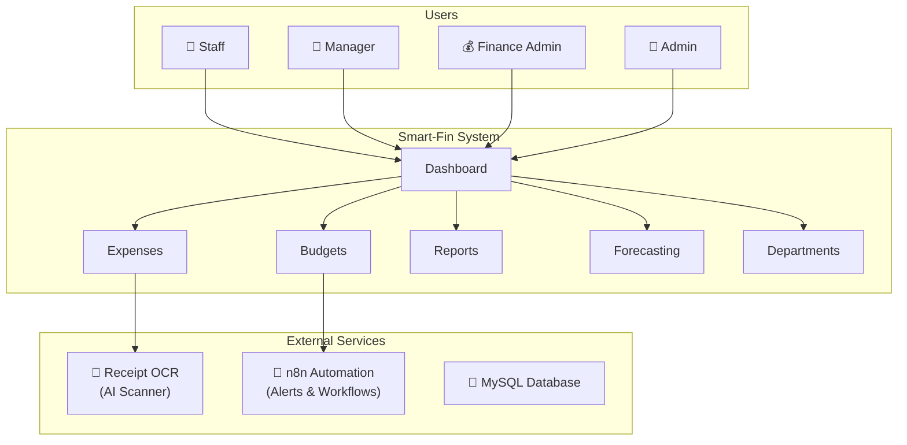

# Smart-Fin 360 - Complete System Workflow Guide 📊

## System Overview



---

## User Roles & Permissions

| Role | Can Do |
|------|--------|
| **Staff** | Submit expenses, view own expenses, view analytics |
| **Manager** | Approve/reject expenses, view reports, forecasting, department expenses |
| **Finance Admin** | Approve budgets, adjust funds, reports, forecasting, manage departments |
| **Admin** | Everything + manage users + manage departments |

---

## Login Credentials

| Role | Email | Password |
|------|-------|----------|
| Admin | `admin@example.com` | `password` |
| Manager | `manager@example.com` | `password` |
| Staff | `staff@example.com` | `password` |
| Finance Admin | `financeadmin@example.com` | `password` |

---

# WORKFLOW GUIDE BY ROLE

---

## 1. Staff Workflow 👷

**Main job:** Submit expense claims, track status, and view personal analytics.

### Available Pages:

| Page | Route | Description |
|------|-------|-------------|
| Dashboard | `/dashboard` | Quick expense submit, overview |
| My Expenses | `/my-expenses` | View all submitted expenses |
| Analytics | `/analytics` | Personal expense analytics & charts |

### Testing Steps:

1. **Login** as `staff@example.com`
2. On Dashboard, find the **"Submit New Expense"** section
3. Click **"Upload Receipt"** and select an image
4. Wait for AI to scan and auto-fill fields
5. Select a **Budget** from the dropdown
6. Click **Submit**
7. View your expense in **"My Expenses"** list
8. Go to **Analytics** (`/analytics`) to see your spending charts

---

## 2. Manager Workflow 👔

**Main job:** Review and approve/reject team expenses, view department data.

### Available Pages:

| Page | Route | Description |
|------|-------|-------------|
| Dashboard | `/dashboard` | Pending expenses, spending charts |
| Expense Approvals | `/expenses/approvals` | Approve/reject expenses |
| Department Expenses | `/manager/expenses` | View all department expenses |
| Forecasting | `/forecasting` | Budget/expense forecasting |
| Budget Report | `/budgets/report` | Budget analytics |

### Testing Steps:

1. **Login** as `manager@example.com`
2. On Dashboard, look for **"Pending Expenses"** section
3. Click **Approve** or **Reject** on expenses
4. Go to **Department Expenses** (`/manager/expenses`) to view team spending
5. Go to **Forecasting** (`/forecasting`) for budget predictions

---

## 3. Finance Admin Workflow 💰

**Main job:** Manage budgets, departments, and monitor financial health.

### Available Pages:

| Page | Route | Description |
|------|-------|-------------|
| Dashboard | `/dashboard` | Overview, alerts |
| Budgets | `/budgets` | Manage all budgets |
| Departments | `/departments` | Manage departments |
| Reporting | `/reporting` | Advanced analytics |
| Forecasting | `/forecasting` | Budget predictions |
| Budget Report | `/budgets/report` | Budget analytics |

### Testing Steps:

1. **Login** as `financeadmin@example.com`
2. Go to **Budgets** page - Approve or Reject pending budgets
3. Go to **Departments** (`/departments`) to manage departments
4. Go to **Reporting** (`/reporting`) for advanced analytics

---

## 4. Admin Workflow 👑

**Main job:** Full system control including user and department management.

### Available Pages:

| Page | Route | Description |
|------|-------|-------------|
| Dashboard | `/dashboard` | Full system overview |
| Users | `/users` | Manage all users |
| Departments | `/departments` | Manage departments |
| Budgets | `/budgets` | View/manage budgets |

### Testing Steps:

1. **Login** as `admin@example.com`
2. Go to **Users** (`/users`) to manage accounts
3. Go to **Departments** (`/departments`) to manage departments

---

# FEATURE DEEP DIVES

---

## Receipt OCR (AI Scanner) 🤖

Reads receipt images and extracts information automatically via Tesseract + Gemini AI.

---

## Department Management 🏢

**Route:** `/departments` | **Access:** Admin, Finance Admin

Manage organizational departments - create, edit, view details.

---

## Forecasting 📊

**Route:** `/forecasting` | **Access:** Finance Admin, Manager

Predicts future budget usage and expense trends.

---

## Staff Analytics 📈

**Route:** `/analytics` | **Access:** Staff only

Shows personal expense analytics and spending charts.

---

# QUICK REFERENCE

## All Routes by Role

| Route | Staff | Manager | Finance Admin | Admin |
|-------|:-----:|:-------:|:-------------:|:-----:|
| `/dashboard` | ✓ | ✓ | ✓ | ✓ |
| `/my-expenses` | ✓ | | | |
| `/analytics` | ✓ | | | |
| `/expenses/approvals` | | ✓ | | |
| `/manager/expenses` | | ✓ | | |
| `/budgets` | | | ✓ | ✓ |
| `/budgets/report` | | ✓ | ✓ | |
| `/departments` | | | ✓ | ✓ |
| `/forecasting` | | ✓ | ✓ | |
| `/reporting` | | | ✓ | |
| `/users` | | | | ✓ |

## URLs

| Service | URL |
|---------|-----|
| Main App | http://localhost:8000 |
| n8n Automation | http://localhost:5678 |
| Python API | http://localhost:5010 |

## Commands to Start System

```bash
docker-compose up -d
npm run dev
```
